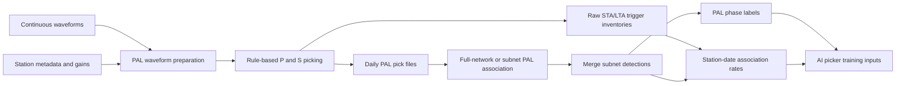

# Run PAL

## Shared Association Tables

Step 2 retains date-wise multiprocessing but shares read-only float32 P/S tables
across its workers. Set ASSOCIATION_TABLE_DIR in the executable: default
"./input" locally, or "/opt/ml/processing/work/input" inside AWS Processing.
The path must be nonempty and writable with room for one uncompressed table
set per distinct station geometry/grid/model encountered. Tables are prepared
once on first use; gains and association thresholds remain worker-specific.
The temporary run directory is removed after workers exit; hard-killed runs may
leave orphan caches. Do not remove a live cache. Original .paltt files and
association results/resume rules are unchanged. See PAL_src/README.md for memory
accounting and cleanup details.

## Optional layered-model travel-time preparation

To derive a model from UCVM, follow the [regional 1D model guide](../preprocess/build_1d_velo_mod/README.md).
Provide its **step-2 output `output/eg/velocity_model_1d.json`** as
`MODEL_FILE` in `0_build_travel_time_table_eg.py`. Copy it to the launcher's
`input/velocity_model_1d.json` to retain the default path, or set its absolute
path. Alternatively, use combined depth/Vp/Vs CSV or paired P/S CRE files;
see [format settings](../PAL_src/VELOCITY_MODEL_FORMATS.md) for the required
model-zero elevation and bottom policy. Datum reports are not model inputs.
Step 3 (CRE export) is optional and is not required for PAL. Review the JSON's
local-surface elevation datum before building. Runtime association consumes the
resulting `.paltt` via `travel_time_table`, not the model JSON directly.

Run `run_pal_local/0_build_travel_time_table_eg.py` before association when
using a layered model. Edit its top-of-file settings: supply your model JSON
at `MODEL_FILE`, station inventory and association config; there is no separate
builder config. The helper is `PAL_src/travel_time_table.py`.
The default input/velocity_model_1d.json is bundled from the generated example.
It demonstrates the interface; replace it with a suitable regional model for
real processing. See the input-folder README for provenance and datum details.

The model JSON uses km and km/s, `depth_reference="local_surface"`,
`depth_positive="down"`, `interpolation="piecewise_constant"`, finite
`model_surface_elevation_km`, and contiguous `layers` with
`top_depth_km`, `bottom_depth_km`, `vp_kmps`, `vs_kmps` (Vp > Vs > 0).
Use schema_version 1 and kind `layered_1d_velocity_model`, with
`units={"depth":"km","velocity":"km/s"}`.

Grid overrides default to None (inherit the selected subnet's config). Solver
defaults are a 200 km cutoff, 111 km/degree, 1e-6 km convergence tolerance,
80 iterations and 32768 cells per CPU batch. Datum defaults extend the first
layer upward and use a finite bottom. Positive/integer and geometry/model
constraints are validated before writing. All controls are documented inline.

`DRY_RUN=True` validates without writing; default False builds.
`OVERWRITE_TABLE=False` protects the input table. Even when True, choose a new
`OUTPUT_DIR` for a rebuild. The completed table is atomically published to
`TABLE_DESTINATION`. Set `subnet_assoc_params["default"]["travel_time_table"]`
to that path to use it; association otherwise retains homogeneous defaults.
Do not replace an input table while workers are reading it.


Range-level PAL exports now include `association_rates_<TIME_RANGE>.csv`
beside the phase/catalog files. It concatenates daily station-date rates with
one header, preserving counts and ratios for negative training sample selection.
All requested daily rate files are required; missing inputs abort export instead
of silently publishing an incomplete table. Daily files remain available.
For completed runs, call `association_runner.combine_daily_association_rates(
assoc_root, time_range, output_path)` to export rates without rerunning association.

Amplitude QC uses matching three-component time windows. If a short ObsPy
slice drops a component or a peak/tail window is empty, the affected QC ratio
is written as `nan` and that check is bypassed. The pick is retained unless
another available QC check fails; trigger counts and time ownership are unchanged.
Completed days remain resumable after a failed run.

PAL magnitude QC requires `mag_min_stations = 3` distinct NET.STA estimates
and population standard deviation <= `mag_max_std = 1.0`. Only finite,
positive calibrated amplitudes contribute. Duplicate station estimates are
collapsed by median; spread is checked without clipping, then the event
magnitude is the median of all valid station estimates.
Failed/unavailable magnitude is written as `-1`; the event and picks remain.
Gain 1.0 is a missing-calibration placeholder, including in legacy station
layouts and same-band fallback. Those traces remain usable for picking.
If any selected component has missing gain, its station amplitude is `nan`
and excluded from magnitude estimation. Other negative magnitudes are
valid. The requested -1 sentinel is indistinguishable from a true ML of exactly
-1 in the phase format and is excluded from event-magnitude merging.
Historical outputs require reprocessing; changing the config does not rewrite them.

Executable rule-based PAL workflows. Source modules are in `../PAL_src/`.

- `run_pal_local/`: workstation download, daily picking, and association examples.
- `run_pal_aws/`: numbered SageMaker submitters plus fixed processing-job
  entry points and monitors for picking and association.

Set `AI_PAL_ROOT` in each copied AWS submitter to the installed source package
(default `~/shared/software/AI-PAL`). The AWS section below documents
SageMaker paths and job controls. Optional legacy PAL location examples are under
`run_pal_local/optional_location/`; the centralized location workflow is
`../4_location/`.

The packaged launchers default to `CASE_CODE = "eg"`, where `eg` means "example".

The files in [run_pal_local/output/eg](run_pal_local/output/eg/README.md)
are illustrative format/content examples, adapted from saved realtime phases.
They are **not the exact results of running the example code** and do not match
its placeholder waveform path, station list, or dates. The example README
documents the source, synthetic diagnostics, schemas, and omitted run artifacts.

## Workflow Overview



The picking and association launchers execute sequential scientific stages. The
remaining sections describe waveform boundaries, configuration, and execution.

The local association launcher publishes the direct range-level products:

```text
output/<case>/phase_<start>-<end>.dat     event headers and station phases
output/<case>/catalog_<start>-<end>.dat   event headers only
```

These are the PAL results intended for location and AI-picker training. The
`picks/`, `pick_logs/`, and `association/` directories retain daily,
diagnostic, and resumable intermediate products.
AWS association jobs publish the same two range-level files at the root of the
exported association result.

## Waveform Edges

### Association overlap and ownership

PAL configs explicitly set `association_buffer_sec = 30.0`, separately from
`data_buffer_sec = 60.0`. For nominal day D, let L = D - 60 s and
R = D + 1 day - 60 s. Buffered association loads neighboring pick files and
selects estimated station origin times in [L - 30 s, R + 30 s).
Final events belong to [L, R) by event origin time, not by P arrival time.
Raw overlapping detections are merged across neighboring days/subnets before
the canonical origin-time cut; this groups boundary duplicates with slightly
different estimated origins.

Finish local picking (including halo days) before starting
association. Local picking checks the requested interval (including halo days)
for completed pick/count/ownership outputs and queues only unfinished dates.
At most `NUM_WORKERS` persistent processes pull dates dynamically, capped to
pending work; completed resumes need no spawned workers. Each worker handles
stations serially, reuses raw tails for consecutive assignments and reads only
the preceding day's final `2 * data_buffer_sec` span after date jumps.
Dates write disjoint daily outputs and require no inter-worker waveform
exchange. The top-level `threads_per_worker` setting controls native numerical
thread pools per process (example default: 2, matching AWS). It is not a station
thread count and does not make every filtering operation multithreaded.
Benchmark 1 versus 2 or more on representative days; avoid oversubscribing the
available CPUs with the product of processes and native threads.
Each worker has a `pick_<range>_worker<N>.log`; parent progress aggregates
completed/skipped days and identifies the worker of the latest station update.
Worker failures stop the run and report the relevant log; completed outputs
remain resumable, and existing completion markers remain valid with overwrite
disabled. Config factories must be importable (as in the examples), and
executable scripts must use their existing `__main__` guard.
Buffered offline association queues pending dates chronologically, one date per
task, rather than assigning fixed date blocks. The existing worker setting is
an upper limit: effective workers = min(requested workers, pending dates).
Fully completed dates are preflight-skipped using the existing policy and
output checks; partially completed dates recheck each subnet in the worker.
All subnets share a date's buffered picks. Persistent processes retain their
table and bounded pick caches, although neighboring workers may read overlapping
pick files. No pending dates means no raw-association pool; merge/finalization
still proceed. Progress includes active PID/date pairs and unexpected worker
exits raise an error. Resume with unchanged settings and overwrite disabled.

See [association performance](../PAL_src/README.md#association-performance)
for per-worker cache memory and diagnostic details.

Changing association buffer mode or seconds invalidates association resume
statuses; old statuses without this policy are recomputed. Picks are unchanged.
Legacy configs without the explicit setting still use the 2*s_win fallback.
The AI ensemble workflow's separate buffer defaults are not changed here.

### Waveform context

PAL uses the same rolling raw-tail strategy as offline AI-PAL. With the default
`data_buffer_sec = 60`, the run seeds its first date from the preceding day's
final 120 s, then caches the current day's final 120 s for the next date.
The cached waveform is merged and gain-corrected but has not yet undergone PAL
detrending, tapering, or filtering. Each date therefore preprocesses 24 hours
plus 120 s while normally opening only the current daily input.

Dates are processed sequentially. Within each date, `num_workers` stations are
read and picked concurrently; all station results are collected before the
cache advances to the following date. Pick-file writes remain centralized.

The file named for nominal date `D` owns P arrivals in
`[D - data_buffer_sec, D + 1 day - data_buffer_sec)`. PAL association and daily
event filtering use the same shifted bounds. `taper_max_length_sec` must not
exceed `data_buffer_sec`. Set `data_buffer_sec = 0` to retain strict UTC-day
ownership without edge context.

## Preparation And Filtering Flags

`to_clean` and `to_filter` control different stages:

- `to_clean = True` selects a usable channel family and location, rejects
  pathological miniSEED fragmentation or overlap, merges fragments, normalizes
  the component layout, and applies station gain/unit conversion. Use this for
  raw local archives. Raw SCEDC S3 objects always require it.
- `to_clean = False` expects the local archive to contain one unambiguous trace
  per component already. Gain and unit conversion are still applied.
- `to_filter = True` applies `freq_band` before PAL picking.
- `to_filter = False` skips only the frequency filter. Alignment, finite-value
  cleanup, gap treatment, detrending, tapering, and edge exclusion remain
  active because PAL still requires a consistent signal array.

Both flags default to `True`, preserving the established raw-data workflow.

## Runtime Reporting

Routine PAL picking and buffered association/merge/finalization reports default
to 60 seconds, configured by `Config.progress_interval_sec` (finite positive
seconds). Startup, failures and final summaries remain immediate. Completed
dates no longer bypass the interval. Detailed per-event diagnostic files are unchanged.

Missing event waveform files are expected for inactive stations and are shown
only with the existing `console_verbosity = "debug"` setting. Default and quiet
console modes suppress these messages; gain fallback, malformed-channel and
other warnings remain visible.

Detailed `[assoc]` attempt/cache reports are hidden in default console mode;
use `console_verbosity = "debug"` to inspect them. See the
[shared-source documentation](../PAL_src/README.md#console-reporting).

## Local Workflow

Local picking reports concise console progress every 30 seconds and after each
completed/skipped day: date, collected station results, completed/skipped days
(including requested halo days), and elapsed time. Detailed station output
stays in the line-buffered pick log. During startup the heartbeat reports
initialization/previous-day context loading. A long-running station can leave
the collected count unchanged while the heartbeat continues. Exceptions appear
on the console and retain their traceback in the log.

Edit the clearly marked user-settings blocks in `run_pal_local/` and run
picking, then association:

```bash
python 1_run_pal_pick_eg.py
python 2_run_pal_assoc_eg.py
```

Station metadata preparation lives in `../preprocess/`. Step 0.2 publishes all
candidate `NET.STA.BAND.LOC` gain epochs with their actual operational periods.
Local examples default to `input/example_pal_format4.sta`. Selection is dynamic
per station-day: `station_selection_order = "channel_first"` (default) or
`"location_first"`, using the configured channel and location priority lists.
Detailed gains are applied to the selected original component before merging.
Location comes from the MiniSEED header, even when the filename omits it.
Local picking prefers an exact band/location/time match, then an active gain
from another location of the same band, then the nearest same-band gain epoch
(preferring the matching location on ties). It does not borrow between bands.
If no compatible gain exists, it uses 1 and retains uncalibrated counts so a
missing gain alone does not discard the waveform. Fallbacks are warned in the
pick log; amplitudes, amplitude-based quality checks, and magnitudes may be
unreliable. Legacy unqualified rows still apply to all bands.
AWS/shared calibration remains strict unless explicitly opted into fallback.
Existing pick outputs are not automatically invalidated: reprocess affected
days and their downstream association outputs after installing this change.
See [station formats](../STATION_FORMATS.md) for compatibility and migration.

`1_run_pal_pick_eg.py` writes picks and sidecars; association reads those
files without rereading waveforms. Keep both launchers' date ranges and pick
directories aligned. The association launcher accepts either a single `full`
station set or subnet keys matching `subnet_assoc_params` in the selected case
config. Local launchers use buffered association; picking includes one extra
nominal day before and after the requested interval.

On resume with overwrite disabled, completed days are checked using their pick
and sidecar files without scanning or reading waveforms. Immediately before a
day needing picking, its previous-day tail is loaded if no consecutive-day
cache is available. An all-complete run does not load waveform context.

Trigger candidates and accepted picks both belong to the shifted daily interval
by refined P time (`tp`), not the initial STA/LTA crossing time. Candidates are
counted before QC, including those subsequently rejected. This keeps accepted
counts bounded by trigger counts even when P refinement crosses a day boundary.

Picking writes one `*.trigger_counts.csv` sidecar per day. Its station counts
record distinct STA/LTA trigger candidates before amplitude-ratio and related
waveform QC. Dominant frequency is not calculated or used as PAL QC.
Association statistics use pre-QC trigger counts.

PAL pick files use the associator-neutral row format:

```text
net_sta,tp,ts,s_amp,p_snr,amp_ratio,A12,A13
```

The rough station origin-time estimate is not persisted. It is derived from
P and S in memory when the PAL associator reads the file. Older PAL pick files
that contain `sta_ot` remain readable.

```text
association_ratio = num_associated_picks / num_picks
num_picks = pre-QC STA/LTA triggers
num_unassociated_picks = num_picks - num_associated_picks
```

This retains station-days whose triggers all fail QC with association ratio
zero. Separated association requires trigger-count and ownership sidecars
created by the current picker. Legacy buffered `.pick` files without ownership
metadata are regenerated once; legacy files remain resumable when
`data_buffer_sec = 0`.

The S picker keeps the PCA amplitude-peak anchor. S STA/LTA first searches from
the earlier of the PCA interval end and half the P-to-S-peak interval through
that peak. Its input prepends the S-LTA window and appends the S-STA window so
the characteristic function is defined over the complete target interval.
The STA/LTA peak sets the earliest S boundary; long kurtosis is calculated only
from there through the S-amplitude peak, and short kurtosis is confined by the
resulting bounds. Rolling kurtosis uses cumulative moments rather than
recalculating every overlapping window.
## AWS Workflow

The `run_pal_aws/` workflow runs PAL directly against daily miniSEED objects
in `s3://scedc-pds/continuous_waveforms`. It does not create a local waveform
archive.

The two numbered root scripts are the complete user-facing workflow:

```text
1_run_pal_pick_aws_eg.py
2_run_pal_assoc_aws_eg.py
config_aws_eg.py
input/
processing_job/
```

All case, date, I/O, retry, parallelism, and SageMaker resource settings are
grouped at the beginning of the numbered scripts. The packaged example uses
`CASE_CODE = "eg"`; copied case workflows should rename the scripts and config
consistently.

`processing_job/` contains fixed implementation files:

```text
job_common.py
monitor_pick_job.py
monitor_assoc_job.py
processing_entry_pick.py
processing_entry_assoc.py
requirements.txt
```

Users normally edit only the numbered root scripts and model parameters in
`config_aws_<CASE_CODE>.py`. The container requirements file is staged and
installed automatically. No separate root requirements file or `PAL_DIR`
environment variable is needed.

### Picking Job

In `1_run_pal_pick_aws_<CASE_CODE>.py`, set at least:

```python
AI_PAL_ROOT = Path("~/shared/software/AI-PAL").expanduser()
CASE_CODE = "eg"
station_file = "station_scedc_aws_selected_20200101_20260701_pal.csv"
time_range = "20200101-20210101"
study_year = 2020

num_workers = 16
overwrite = False
retry_failed_dates = False
instance_type = "ml.c5.9xlarge"
threads_per_worker = 2
```

`time_range` uses an exclusive end date and must match the full `study_year`.
Station intervals are half-open (`t0 <= date < t1`).

Submit and monitor from `run_pal_aws/`:

```bash
AWS_DEFAULT_REGION=us-west-2 python 1_run_pal_pick_aws_eg.py
python processing_job/monitor_pick_job.py
```

The submitter stages its runtime JSON, config, station file, and required
`PAL_src` modules. Existing output is restored when
`resume_existing_output = True`; completed daily status files are then skipped
according to the runner settings. AWS dates run sequentially, while
`num_workers` controls concurrent station processing within the current date.
This keeps one rolling preceding-day tail cache and avoids repeated neighboring
day reads.

Daily outputs are stored under the default SageMaker bucket:

```text
sagemaker/scsn-pal/results/<CASE_CODE>-pick-<YEAR>/output/<CASE_CODE>/
```

### Association Job

In `2_run_pal_assoc_aws_<CASE_CODE>.py`, set the subnet station mapping,
`time_range`, `study_year`, worker count, instance settings, and pick job
codes. Subnet keys must match `subnet_assoc_params` in the selected case config.
By default PAL derives each horizontal search range from the active stations and
`xy_margin`. Set `lat_range` and `lon_range` in the `default` or a subnet override
to fixed `[minimum, maximum]` bounds when station geometry is not representative.

The primary pick prefix must contain every target day. Set
`association_buffer_enabled = False` for independent-day training-label
association; in that mode `boundary_pick_objects` should remain empty. Buffered
association remains available for workflows that require cross-midnight event
continuity, where optional boundary objects provide the adjacent picks. Submit
only after the required picking outputs exist:

```bash
AWS_DEFAULT_REGION=us-west-2 python 2_run_pal_assoc_aws_eg.py
python processing_job/monitor_assoc_job.py
```

The submitter verifies both each daily `.pick` file and its matching
`*.trigger_counts.csv` inventory before creating the association job.

With independent-day association, every subnet reads only the target day's
picks and canonical merging uses only that day's subnet outputs. With buffered
association enabled, the expanded interval and cross-day duplicate merging are
retained.

Association output is stored under:

```text
sagemaker/scsn-pal/results/<CASE_CODE>-assoc-<YEAR>/output/<CASE_CODE>/
```

It contains `phase_<start>-<end>.dat` and `catalog_<start>-<end>.dat` as the
direct final products. Daily subnet and merged products, event-group records,
association-rate CSVs, logs, and resumable status files are kept below
`association/`. The association monitor aggregates daily pick,
associated-pick, and event counts by month.

### Source Components

The submitters stage the current implementations from `AI_PAL_ROOT/PAL_src`,
including AWS waveform access, picking and association runners, PAL models,
rolling waveform context, phase merging, and picker-ensemble metadata support.
Station files remain under
`run_pal_aws/input/`.
### Waveform rules

For each date, the pipeline chooses the available band/location using the same
configurable priorities as local PAL. Station metadata is keyed by `NET.STA`;
detailed inventory gains match the actual selected band/location and sample
time. Three components are ordered as E/N/Z. For one-component data, that component is copied three times. For
two-component data, Z is copied three times when present; otherwise the first
horizontal component is copied three times.

Channels whose SEED instrument code is `N`, such as `HN`, are gain-corrected as
acceleration and integrated once to velocity before PAL's normal 1-20 Hz
preprocessing. Velocity channels are gain-corrected without integration.

## AWS Example Inputs

Files under `run_pal_aws/input/` provide the full SCEDC picking station list and six subnet station lists used by the example launchers. Replace them with case-specific station epochs before running another network or study period.
